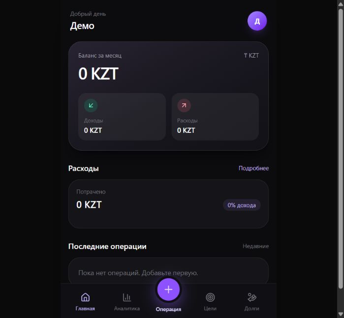

# Finovo — Telegram Finance Tracker

> Личный продукт · [Telegram-бот](https://t.me/finovo_tracker_bot) · [Mini App](https://finovo-tracker.royalapple256.chatgpt.site)

Finovo — Telegram-бот и Mini App для личного учёта финансов. Доход или расход можно быстро добавить сообщением в чате, а затем посмотреть сводку, цели, долги и аналитику в приложении.



> На экране — синтетический аккаунт «Демо» с нулевыми суммами. Репозиторий не содержит реальных операций, банковских реквизитов, токенов или пользовательских данных.

## Стек

- Next.js 16, React 19 и TypeScript
- Cloudflare Workers / D1 и Drizzle ORM
- Tailwind CSS, shadcn/ui и Recharts
- Telegram Bot API и Telegram Mini App
- CSV/TSV, XLSX и текстовый PDF-импорт на стороне браузера

## Что можно проверить

- Быстрый ввод операций: `кофе 1200`, `такси 3500`, `+ зарплата 450000`, `кофе 5 USD`.
- Сводки в боте: `/today`, `/month` и `/help`.
- Тесты импорта банковских выписок, PDF-парсинга и защиты от повторной доставки Telegram webhook.
- Локальная проверка: `npm run lint`, `npx tsc --noEmit`, `node --test tests/bank-import.test.mjs tests/kaspi-pdf.test.mjs tests/telegram-reset-dedupe.test.mjs`, `npm run build`.

Откройте бота, нажмите «Запустить», затем кнопку «Открыть финансы» в чате. Компьютер для работы бота держать включённым не нужно: приложение опубликовано на Sites, данные хранятся в Cloudflare D1.

## Возможности

- Быстрая запись сообщениями: `кофе 1200`, `такси 3500`, `+ зарплата 450000`, `кофе 5 USD`.
- Команды `/today` и `/month` для сводок, `/help` для подсказки.
- Доходы, расходы и последние операции с датой и временем в тёмном интерфейсе. В профиле можно создать пресеты категорий; в операции доступны пресеты, «Другое» и чекбокс сохранения новой категории.
- Импорт банковской выписки из CSV/TSV, XLSX и текстового PDF Kaspi Gold (до 2 МБ и 500 операций) внутри Mini App: предпросмотр, автоматическое определение столбцов с ручной корректировкой, выбор категорий и исключение отдельных строк до сохранения. Для каждого счёта задаётся название источника: при повторной загрузке нужно использовать то же название. Повторные операции из выписок не добавляются, возможные совпадения с ранее внесёнными операциями и автоплатежами по кредитам выделяются отдельно. Исходный файл разбирается в браузере и сам файл не загружается на сервер; выбранные пользователем распознанные операции отправляются в приложение только при сохранении. Сканированные PDF и PDF других банков пока не поддерживаются; если в PDF Kaspi Gold есть ошибки разбора строк, импорт блокируется целиком до исправления, чтобы не пропустить операции незаметно.
- Отдельные вкладки целей и долгов; кредиты находятся в долгах. Для кредита задаются ежемесячный платёж, общий срок, число уже оплаченных месяцев и дата следующего платежа. Общая сумма и окончательная дата погашения вычисляются автоматически, прогресс показан кольцом и счётчиком месяцев.
- Аналитика по месяцам с переключением и категории расходов; суммы по валютам отдельно: KZT — основная, RUB, USD и EUR — дополнительные.
- Идемпотентная облачная обработка графика: в дату платежа в 00:00 по Asia/Qyzylorda создаётся учётный расход, а за 7, 3 и 1 день бот отправляет напоминание. Это **учётная запись**, а не настоящее банковское списание. Для работы без открытого приложения нужно подключить Site MCP-плагин и включить ежедневное облачное расписание; одна публикация кода сама по себе фоновый запуск не включает.
- Адаптивный интерфейс для iPhone и десктопа.
- Данные каждого человека изолированы по проверенной Telegram-подписи. Вне Telegram финансовые данные и API недоступны.

Сейчас «итог за месяц» означает доходы минус расходы за текущий месяц, а не остаток по банковским счетам. Курсы валют не запрашиваются и разные валюты не складываются. Даты в сводках и кредитном графике считаются по часовому поясу Asia/Qyzylorda (UTC+5). Если фоновая задача задержится, расход всё равно попадёт на дату платежа с временем 00:00. Фактическая отправка сообщения точно в секунду не гарантируется. Автоматической синхронизации с банком нет: выписка загружается вручную. Переводы между собственными счетами и уже учтённые платежи по кредитам нужно исключать в предпросмотре, чтобы не завышать итог.

## Локальный запуск

```powershell
npm ci
npm run build
node --import ./scripts/sites-env.mjs ./node_modules/wrangler/bin/wrangler.js d1 execute DB --local --config dist/server/wrangler.json --persist-to .wrangler/state --file drizzle/0000_pale_blue_marvel.sql
node --import ./scripts/sites-env.mjs ./node_modules/wrangler/bin/wrangler.js d1 execute DB --local --config dist/server/wrangler.json --persist-to .wrangler/state --file drizzle/0001_superb_celestials.sql
node --import ./scripts/sites-env.mjs ./node_modules/wrangler/bin/wrangler.js d1 execute DB --local --config dist/server/wrangler.json --persist-to .wrangler/state --file drizzle/0002_naive_mikhail_rasputin.sql
node --import ./scripts/sites-env.mjs ./node_modules/wrangler/bin/wrangler.js d1 execute DB --local --config dist/server/wrangler.json --persist-to .wrangler/state --file drizzle/0003_remarkable_hemingway.sql
npm run dev
```

На `localhost` доступен демонстрационный пользователь. Для проверки качества кода: `npm run lint`, `npx tsc --noEmit`, `npm run build`.

## Конфигурация

Имена переменных хостинга: `TELEGRAM_BOT_TOKEN` и `TELEGRAM_WEBHOOK_SECRET` (секреты), `MINI_APP_URL` (HTTPS-адрес), `MCP_OWNER_ID` (ID владельца Site для защищённого инструмента фонового запуска). Значения настроены на Sites и не хранятся в Git. Для локальной разработки можно создать незакоммиченный `.dev.vars`; токены и секреты не добавлять в исходники.

`config/hosting.example.json` — безопасный шаблон для публичного клона. Для реального Sites-проекта создайте локальный `.openai/hosting.json`: он игнорируется Git и имеет приоритет при сборке. Публичный адрес нужен, чтобы Telegram мог доставлять webhook и открывать Mini App у друзей. Запись в API разрешена только с действительной Telegram-подписью; webhook отдельно защищён секретным заголовком. Инструмент обработки графика доступен только владельцу Site через его ChatGPT-авторизацию. Повторная доставка одного сообщения или повторный запуск обработки графика не создают дублирующую операцию.
